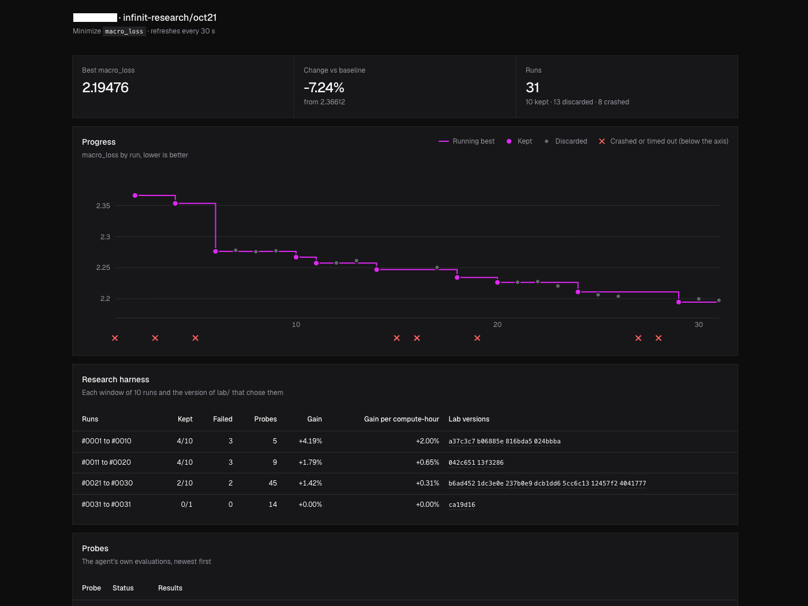

# infinit-research

A Claude Code plugin for autonomous, overnight code optimization. Define a metric, freeze the evaluation harness, and let an agent experiment: improvements are committed, regressions reverted. The agent also evolves its research strategy based on results.

Inspired by [karpathy/autoresearch](https://github.com/karpathy/autoresearch), [fractalsearch](https://github.com/MaxRobinsonTheGreat/fractalsearch), and [Harness²](https://arxiv.org/abs/2610.14224).




## Install

```bash
claude plugin install infinit-research --marketplace raphaelDkhn/infinit-research
```

Requires Python 3.9+.

## Quick start

Define what to optimize:

```text
/infinit-research:new make src/sort.rs as fast as possible
```

Start the autonomous loop:

```bash
caffeinate -is claude --permission-mode dontAsk --effort max --model opus "/infinit-research:run"
```

Monitor progress and stop when you want:

```bash
open .infinit-research/report.html
touch .infinit-research/stop
```

## How it works

1. **Define the objective.** A TOML contract specifies the metric, run command, timeout, and editable files.
2. **Freeze evaluation.** An independent harness measures every experiment. The agent cannot change how success is judged.
3. **Experiment autonomously.** Improvements are kept; regressions are reverted and remain recoverable.
4. **Improve the research process.** Every 10 runs, the agent reviews its strategy, evaluations, and lessons against experimental results.

The agent can write logs and artifacts to `$INFINIT_RESEARCH_RUN_DIR`.

## Development

```bash
uv sync && uv run pytest && prek install
claude --plugin-dir .
```
